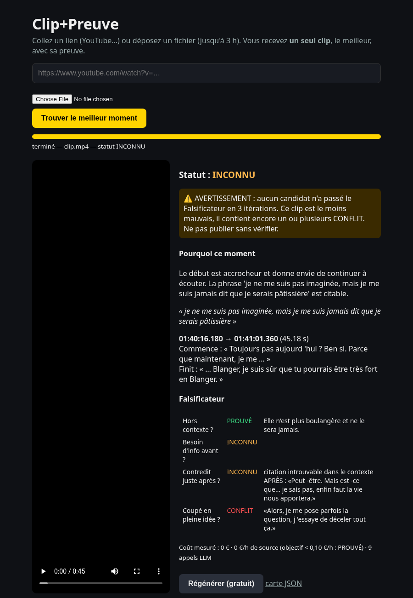
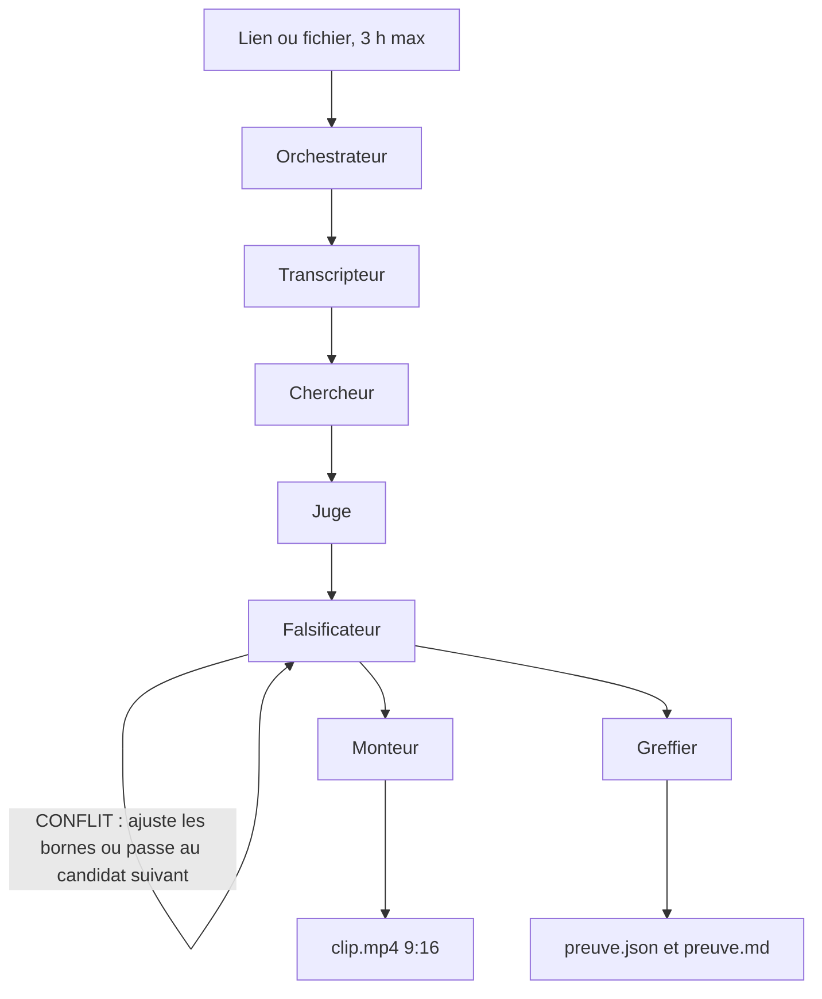

# Clip-preuve

[](https://github.com/haynbroit-alt/Clip-preuve/actions/workflows/ci.yml)

Un lien ou un fichier vidéo (jusqu'à 3 h) entre, **un seul** clip vertical de 20 à 90 secondes sort.
Avec le clip, une carte de preuve : timestamps, citations exactes de début et de fin, raison du choix.
Avant de le rendre, un Falsificateur essaie de le casser — hors contexte, info préalable, contredit juste après, coupé en pleine idée — et marque chaque test **PROUVÉ**, **INCONNU** ou **CONFLIT**.

## English

Paste a video link or file (up to 3 hours). Clip-preuve returns one 20–90s vertical clip and a proof card (timestamps, exact opening and closing quotes, and why this moment). A separate Falsificateur pass tries to break the clip first. Run `./install.sh` once, then `./clip "<url>"`, or `./clip --ui` for the local web page.

## Utilisation

```bash
./install.sh                                  # une fois (Linux, ffmpeg, Python 3.11+)
./clip "https://www.youtube.com/watch?v=..."  # runs/<id>/clip.mp4 + preuve.md
./clip --ui                                   # http://127.0.0.1:8000
```

`./install.sh` prépare le venv, llama.cpp et le modèle local (Qwen2.5-7B, CPU, 0 € d'API).
Optionnel : `export OPENROUTER_API_KEY=...` pour un modèle OpenRouter à la place. La clé reste dans l'environnement, elle n'est ni affichée ni journalisée.

Régénérer sans refaire la transcription : `./clip "<lien>" --regenerer`. Chaque clip garde sa carte (`preuve_<n>.json` / `.md`) ; `preuve.json` / `preuve.md` sont toujours la dernière.


L'interface : un champ, un bouton, la progression, la vidéo, « Pourquoi ce moment », et Régénérer.



## Carte de preuve

Chaque run écrit `preuve.json` et `preuve.md`. Les citations sont les mots de la transcription, pas une réécriture du modèle. La phrase clé proposée par le juge n'est affichée que si elle est retrouvée dans la transcription du clip ; sinon la carte indique « Phrase clé : INCONNU ». « Pourquoi ce moment » est l'avis du juge (IA), signalé comme non vérifié. Les quatre tests du Falsificateur y figurent un par un. Si rien ne tient, le statut est **INCONNU** et l'avertissement est en tête.

- Exemple réel (conflit restant) : [docs/exemple_preuve.md](docs/exemple_preuve.md)
- Exemple sans conflit, avec un critère encore inconnu : [docs/exemple_preuve_sans_conflit.md](docs/exemple_preuve_sans_conflit.md)
- Piège « l'erreur que tout le monde fait… » puis la correction : [docs/test_piege_resultat.json](docs/test_piege_resultat.json)

## Architecture



Le détail des six agents, de leurs prompts (`skills/`) et des artefacts de `runs/<id>/` est dans [docs/ARCHITECTURE.md](docs/ARCHITECTURE.md).

## Tests

La suite unitaire ne télécharge ni Whisper ni le LLM : les deux sont simulés.

```bash
python3 -m pip install -r requirements-dev.txt
pytest
ruff check .
```

`python tests/trap_test.py` rejoue le piège contre le LLM réellement lancé. Ce n'est pas la CI.

## Limites

- CPU seulement : une source de 3 h prend environ 30 à 40 minutes. Les durées sont dans `timings.json`.
- Le Falsificateur est sévère. Un garde-fou lexical rattrape le cas où le clip s'arrête avant la correction de l'orateur.
- Le recadrage suit le visage dominant (mediapipe). Sans visage, le cadre reste centré. Avant / après : [docs/avant_apres.png](docs/avant_apres.png).

Licence MIT — Copyright (c) 2026 Lhassan Charfa.
