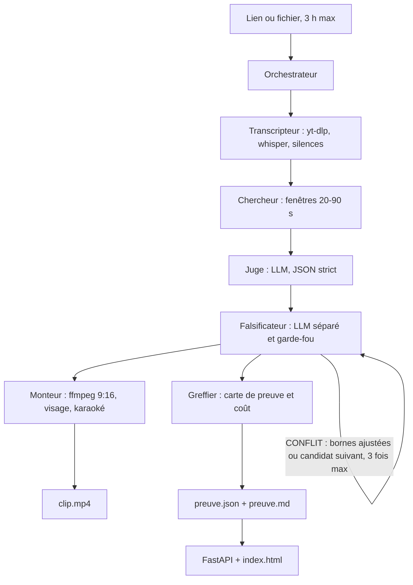

# Architecture

Clip-preuve enchaîne six agents. L'orchestrateur (`orchestrator.py`) ne choisit pas le moment : il passe les artefacts du dossier `runs/<id>/` de l'un à l'autre. Les prompts vivent dans `skills/`, séparés du code.

| Agent | Code | Prompt | Sortie |
|---|---|---|---|
| Transcripteur | `agents/transcripteur.py` | `skills/transcripteur.md` | `source.json`, `words.json`, `silences.json` |
| Chercheur | `agents/chercheur.py` | `skills/chercheur.md` | `sentences.json`, `topics.json`, `candidates.json` |
| Juge | `agents/juge.py` | `skills/juge.md` | `scores.json` |
| Falsificateur | `agents/falsificateur.py` | `skills/falsificateur.md` | `falsification.json` |
| Monteur | `agents/monteur.py` | `skills/monteur.md` | `clip.mp4`, `crop.json`, `subs.ass` |
| Greffier | `agents/greffier.py` | `skills/greffier.md` | `preuve.json`, `preuve.md` |

Le client LLM unique est `agents/llm.py` (llama.cpp sur `127.0.0.1:8088` par défaut, OpenRouter si `OPENROUTER_API_KEY` est défini). Chaque appel est ajouté à `llm_calls.jsonl` avec les jetons, la durée et le coût en euros, et une ligne JSON part sur stderr (`agents/log.py`). La clé n'est ni affichée ni journalisée. Le coût local est 0 € d'API.

Les sorties du juge et du Falsificateur passent par les modèles pydantic de `agents/contracts.py`. Un verdict hors `PROUVÉ` / `INCONNU` / `CONFLIT` devient `INCONNU`. Le score du juge continue de borner chaque note entre 0 et 10 ; la note brute reste celle qui est écrite sur la carte. La carte elle-même suit `schemas/preuve.schema.json`.

## Les quatre tests

Pour le clip retenu, le Falsificateur répond, puis un garde-fou lexical peut aggraver le verdict (CONFLIT l'emporte sur INCONNU, qui l'emporte sur PROUVÉ) :

1. **Hors contexte** — le clip seul fait-il dire autre chose que ce que l'orateur pense ?
2. **Info préalable** — faut-il une information donnée seulement avant ?
3. **Contredit juste après** — l'orateur corrige-t-il l'affirmation dans la minute qui suit ?
4. **Coupé en pleine idée** — la fin tombe-t-elle au milieu d'une phrase ou d'un raisonnement ?

Une citation de correction ne compte que si elle se retrouve dans le contexte *après* le clip. Le garde-fou force **CONFLIT** quand le clip porte une affirmation du type « l'erreur que tout le monde fait » et que la correction (« c'est faux », « en réalité »…) arrive dans les 40 secondes suivantes, même si le modèle a répondu « aucune ».

Le verrou de livraison (`agents/livraison.py`) relit le verdict déjà produit et refuse d'écrire le fichier si un critère est CONFLIT. Le cadrage locuteur (`agents/locuteur.py`) ne change de visage qu'après 1,5 s de bouche active pendant la parole. L'évaluation des coupes au milieu d'une idée est dans `agents/eval_bornes.py` et `tests/eval/`.

## Entrées

- CLI : `./clip` appelle `orchestrator.py`.
- Web : `./clip --ui` lance `app.py` (FastAPI) et `index.html`. Un job à la fois.
- Comparaison manuelle : `python compare.py runs/<id> --manuel clip_humain.mp4`. Sans fichier de référence, le verdict est INCONNU.
